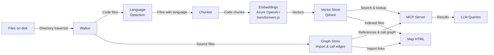

# Architecture

repolens is a codebase indexing system designed to prepare source code for LLM consumption. It extracts code symbols, embeds them, and serves them through an MCP server.

## Modules

- **cli**: Command-line interface (entry point, built on commander)
- **walker**: Walks a directory, honouring nested .gitignore files and skipping binary and oversized files
- **language**: Detects a file's language from its extension or shebang
- **chunker**: `chunkFile(path, language, source)` returns symbol-level chunks (function, method, class, interface, type, enum) with path, language, name, kind, parent, line range and content hash. `parser.ts` loads tree-sitter WASM grammars once; one adapter per language extracts symbols (TS/JS, Python, C#); `fallback.ts` splits other files into 60-line windows
- **embeddings**: `EmbeddingProvider` converts text to vectors. `AzureEmbeddingProvider` (fetch, 1536 dims) and `LocalEmbeddingProvider` (transformers.js, 384 dims) share `embedInBatches` for batching and retry with backoff. `createEmbeddingProvider` picks one from `REPOLENS_EMBEDDINGS`
- **store**: `VectorStore` interface (upsert, deleteByPath, listIdsByPath for incremental indexing, filtered search) with `InMemoryVectorStore` for tests and `QdrantVectorStore` over the Qdrant REST API. Both pass one shared contract test; chunk ids come from `chunkId`
- **indexer**: `indexRepository` walks, chunks and embeds a directory into a store. A file is re-embedded only when its set of chunk ids (path, start line, content hash) differs from the stored set; deleted files are removed. Embedding happens before the old chunks are deleted, so a failed run leaves the previous index intact
- **search**: `searchIndex` embeds a query and asks the store for the nearest chunks (path and language filters); `formatHits` renders them for the terminal
- **doctor / runtime**: `runDoctor` checks Node, Qdrant and the embedding config; `createRuntime` builds the Qdrant store and embedding provider from environment variables
- **mcp**: `createServer` registers six read-only tools on `@modelcontextprotocol/sdk` (`search_code`, `get_symbol`, `list_files`, `file_context`, `find_references`, `call_graph`) with zod input schemas. The tool logic lives in `tools.ts` as plain functions over a `Runtime`; `server.ts` only validates input and turns failures into MCP error results. `repolens serve` connects it to stdio. Tools read chunks through `VectorStore.findChunks` (exact path and/or name), `listIdsByPath` and `search`; the two graph tools read edges through `GraphStore.findEdges`
- **graph**: `GraphStore` holds import and call edges (`GraphEdge`: path, kind, target name, optional module, enclosing symbol and line) extracted per file by tree-sitter adapters for TS/JS, Python and C#. `InMemoryGraphStore` and `QdrantGraphStore` share a contract test; `findEdges` does exact lookups by kind, target, from and path. Targets are names as written, not resolved, so every query is name-based
- **map**: `buildMapData` turns the index into file nodes and weighted import links. Relative TS/JS specifiers and Python modules are resolved to indexed paths by path alone (no disk access); everything else is counted as unresolved. `renderMapHtml` renders that data as one self-contained HTML page with an inline force-directed layout, zoom, search and language filter. `repolens map` writes it to a file

## Data Flow

