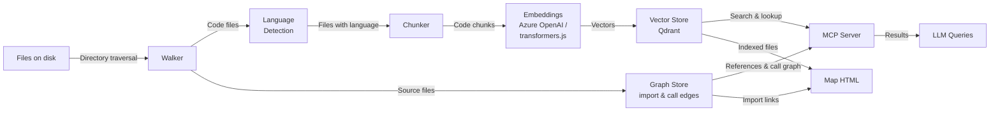

# Architecture

repolens is a codebase indexing system designed to prepare source code for LLM consumption. It extracts code symbols, embeds them, and serves them through an MCP server.

## Modules

- **cli**: Command-line interface (entry point, built on commander)
- **walker**: Walks a directory, honouring nested .gitignore files and skipping binary and oversized files
- **language**: Detects a file's language from its extension or shebang
- **chunker**: `chunkFile(path, language, source)` returns symbol-level chunks (function, method, class, interface, type, enum) with path, language, name, kind, parent, line range and content hash. `parser.ts` loads tree-sitter WASM grammars once; one adapter per language extracts symbols (TS/JS, Python, C#, Java, Go, Rust, Ruby, PHP, Kotlin, Swift, C, Scala, C++); `fallback.ts` splits other files into 60-line windows
- **embeddings**: `EmbeddingProvider` converts text to vectors. `AzureEmbeddingProvider` (fetch, 1536 dims) and `LocalEmbeddingProvider` (transformers.js, 384 dims) share `embedInBatches` for batching and retry with backoff. `createEmbeddingProvider` picks one from `REPOLENS_EMBEDDINGS`
- **store**: `VectorStore` interface (upsert, deleteByPath, listIdsByPath for incremental indexing, filtered search) with `InMemoryVectorStore` for tests and `QdrantVectorStore` over the Qdrant REST API. Both pass one shared contract test; chunk ids come from `chunkId`
- **indexer**: `indexRepository` walks, chunks and embeds a directory into a store. A file is re-embedded only when its set of chunk ids (path, start line, content hash) differs from the stored set; deleted files are removed. Embedding happens before the old chunks are deleted, so a failed run leaves the previous index intact
- **watch**: `watchRepository` listens to a recursive `fs.watch` on the root and reruns an indexing pass after a quiet period (debounce). Passes never overlap: events during a pass trigger exactly one follow-up pass, `.git` changes are ignored and a failing pass goes to `onError` without stopping the watcher. `repolens watch <path>` and `repolens serve --watch <path>` use it
- **search**: `searchIndex` embeds a query and asks the store for the nearest chunks (path and language filters). In `hybrid` mode (the default) `extractIdentifiers` pulls code-like tokens (`parseConfig`, `load_settings`, `AuthService.login`) out of the query and looks them up by exact symbol name with `findChunks`; name matches are ranked first (those the vector search also found, by score, then the rest), followed by the remaining vector hits. `semantic` mode skips the name lookup. `formatHits` renders hits for the terminal
- **doctor / runtime**: `runDoctor` checks Node, Qdrant and the embedding config; `createRuntime` builds the Qdrant store and embedding provider from environment variables
- **mcp**: `createServer` registers six read-only tools on `@modelcontextprotocol/sdk` (`search_code`, `get_symbol`, `list_files`, `file_context`, `find_references`, `call_graph`) with zod input schemas. The tool logic lives in `tools.ts` as plain functions over a `Runtime`; `server.ts` only validates input and turns failures into MCP error results. `repolens serve` connects it to stdio. Tools read chunks through `VectorStore.findChunks` (exact path and/or name), `listIdsByPath` and `search`; the two graph tools read edges through `GraphStore.findEdges`
- **graph**: `GraphStore` holds import and call edges (`GraphEdge`: path, kind, target name, optional module, enclosing symbol and line) extracted per file by tree-sitter adapters for TS/JS, Python, C#, Java, Go, Rust, Ruby, PHP, Kotlin, Swift, C, Scala and C++. `InMemoryGraphStore` and `QdrantGraphStore` share a contract test; `findEdges` does exact lookups by kind, target, from and path. Targets are names as written, not resolved, so every query is name-based
- **map**: `buildMapData` turns the index into file nodes and weighted import links. Each language has an `ImportResolver` (`paths.ts` holds the contract and helpers): `resolve.ts` covers TS/JS, Python, C/C++ includes, Ruby requires and PHP `use`/`require`; `resolve-modules.ts` covers Java/Kotlin/Scala class paths, Go packages and Rust `crate`/`self`/`super` paths. Resolution is by path alone against the indexed files (no disk access); Go module paths come from indexed `go.mod` files read back from the store. A resolver may return several files (a Go package, a JVM wildcard). Packages, C# namespaces and Swift modules are counted as unresolved. `renderMapHtml` renders that data as one self-contained HTML page with an inline force-directed layout, zoom, search and language filter. `repolens map` writes it to a file
- **bench**: `runBenchmark` indexes a directory into a given store, then runs a list of `{ query, expect }` questions through `searchIndex` and reports index time, search latency percentiles, Recall@k and MRR. `repolens bench` uses an in-memory store by default so a benchmark never touches the real index

## Data Flow

