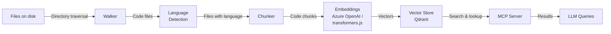

# Architecture

repolens is a codebase indexing system designed to prepare source code for LLM consumption. It extracts code symbols, embeds them, and serves them through an MCP server.

## Modules

- **cli**: Command-line interface (entry point, built on commander)
- **walker**: Walks a directory, honouring nested .gitignore files and skipping binary and oversized files
- **language**: Detects a file's language from its extension or shebang
- **chunker**: `chunkFile(path, language, source)` returns symbol-level chunks (function, method, class, interface, type, enum) with path, language, name, kind, parent, line range and content hash. `parser.ts` loads tree-sitter WASM grammars once; one adapter per language extracts symbols (TS/JS, Python, C#); `fallback.ts` splits other files into 60-line windows
- **embeddings**: `EmbeddingProvider` converts text to vectors. `AzureEmbeddingProvider` (fetch, 1536 dims) and `LocalEmbeddingProvider` (transformers.js, 384 dims) share `embedInBatches` for batching and retry with backoff. `createEmbeddingProvider` picks one from `REPOLENS_EMBEDDINGS`
- **store**: `VectorStore` interface (upsert, deleteByPath, listHashesByPath for incremental indexing, filtered search) with `InMemoryVectorStore` for tests and `QdrantVectorStore` over the Qdrant REST API. Both pass one shared contract test; chunk ids come from `chunkId`
- **mcp**: MCP server that exposes search and navigation to LLMs (M3)
- **graph**: Symbol graph for fast code navigation (M3)

## Data Flow

